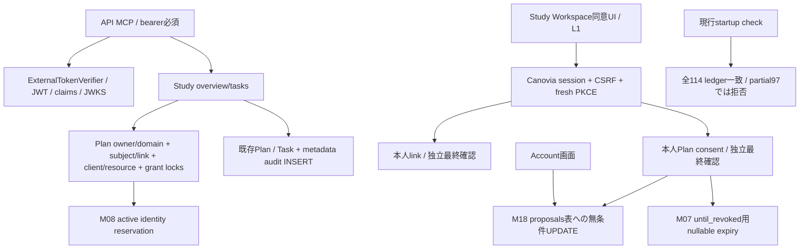

# AP-first Read-only release feasibility — 2026-10-20 JST

正本 [Issue #488](https://github.com/1kz-ma1/Canovia-web/issues/488)。**AP_FIRST_FEASIBILITY_REVIEW / REAL_AIVEN_UNVERIFIED / PRODUCTION_NO_GO_HOLD**。
本書は調査・合成検証の結果であり、リリース候補の採用、実接続、設定変更、mergeの承認ではない。

## 結論と学習開始

**今は手動共有で学習を開始する案4を推奨し、標準e858リリースの審査（案1）を時間制限付きで並行する。速攻バックポート（案2）は非推奨。**
Read本体は実装済みだが、旧94 schemaでは現行コードの本人リンク・同意・Account画面が完結しない。加えて、既存promotion契約、実Auth0/Plan承認、復旧、実機受入は未達。現時点で48〜72時間以内の安全な公開を約束できる根拠はない。

監査開始2026-10-20 JSTから48時間（10/22）でP0実証の担当・取得経路・日程を判定し、遅くとも72時間（10/23）で見通しが立たなければ試験前の先行公開追求を停止する。ユーザー目標日11/10まで、非必須の機能追加・複数レーン拡張は再開しない。これは公式試験日程の独立確認ではない。

手動共有はユーザーが選ぶPlan概要・期限・今週の範囲・弱点・最近10問ごとの集計で足りる。Canovia自体をAIが読まず、Task完了や習熟を自動更新しない。Token、本人/Planの内部ID、権利未確認の問題bank本文は不要。

## CURRENT — ソース、観測、受入を分離

| 対象 | 固定値・証拠 | 現在の判定 |
| --- | --- | --- |
| GitHub main / source audit candidate | `e858b9c855970fbe73f37a2d60c9db6525b132d6`、tree `f6990e8bcf7904be2fdc2706d6a525a29ccef9ee` | 今回native Git/APIで再確認。AUDIT_CANDIDATE_ONLY |
| 新release | `release/2026-10-19-e858b9c8` → e858同SHA | 再確認、不変 |
| 旧release | `release/2026-10-19-c09a8fc7` → `c09a8fc718c338f98a4045a4b5f2260c7571fdaa` | 再確認、不変 |
| production branch | `15abdc9de6f24b5250fb255c579d1aa55facaf1a` | Gitで再確認。branch一致はLive/DBの証明ではない |
| Render Web Live | 同15abdc9d / `dep-db5fgl942hec738pbq30` / `srv-dagfn2id0e5s73cac7ng`、My Workspace、監視branch=main、AutoDeploy=no/off | [10/20既存read-only証跡](https://github.com/1kz-ma1/Canovia-web/issues/488#issuecomment-6277685866)を再利用。**本セッションにRender connectorなし、直接再観測はUNKNOWN** |
| MCP synthetic Stage Live | `1e93b6ce17b29e0b029b78293462839fdcbd5a80` / `srv-db43l4nlk1mc73emseig`、AutoDeploy=no/off | 同既存証跡。直接再観測UNKNOWN。Development合成fixture専用、実APへ転用禁止 |
| real AP pilot | mainにコードあり、LiveにはStudy toolなし | 実OAuth・既存本人Plan・Web/iOS/ChatGPT E2E未実証。利用可能とは判定しない |

Renderのenv一覧・保存・deploy API、Auth0/live endpoint、実Aivenへはアクセスしていない。AutoDeploy OFFはenv変更や手動deployの抑止保証ではない。

## 正確な差分・最小依存の到達範囲

旧Live source15abdc9d → e858は**313 commits / 1,020 paths（793 A /227 M /0 D）**。94既存migrationは全blob不変、追加20、全114。古い[10/15 inventory](MCP_AP_PRIVATE_PILOT_PINNED_RELEASE_INVENTORY_2026_10_15.md)のe81e・643 paths・18件を現行へ転記しない。

既存 `integrated_release20_audit.source()` で114件のbasename→Git blob集合を再計算：seal `a3494c1d1cf60546a86312f249f7d44b2ac52e44669752a65e1c70011ec9f91b`。このsealは**e858 sourceのみ**。別案のsource/partial97へ流用しない。旧c09候補から変更された追加migrationはM01/M08/M18/M19/M20。

[依存manifest・全ファイル名・全20 migration・再現probe](AP_FIRST_READ_RELEASE_DEPENDENCIES_2026_10_20.md)を併読する。Phase Aの実行経路、OFFでもautoloadするB/C/D、共通UIの保守的class-reference closureを別々に列挙した。closureは最小cherry-pickリストではない。遅延メソッド・共有model・View内container解決を含むため、バックポートを完成/デプロイ可能とは認定しない。

### 閉じたPhase Aデータ経路で確認した点

- `routes/api.php` は新旧blob同一だが、呼出先 `McpReadOnlyResourceController.php` とservice群は異なる。route名やflagの存在だけでは旧Liveを有効化できない。
- controllerのmethod injectionはStudy/summary/snapshot/proposalとserviceを**flag判定前に解決**する。B/C/DをOFFにすれば読取/提案処理は実行しないが、ファイルを省いた単純な移植では依存classを失う。
- `McpReadOnlyStudyContextTool.php` はPlan→link→grantをtransaction/lock下で確認。scope=overviewはtitle/deadlineだけ、tasksはactive Taskをlimit+1で取得し最大8件、本文は160文字上限。問題・回答・思考・他Planを取得しない。
- 「Read-only」はPlan/Task/学習実績を変更しない意味。毎回 `mcp_delegated_access_events` にmetadata INSERTする。同意・link/revokeも認可metadataを更新する。**監査用REFERENCES＋ledger SELECT principalをアプリ用に流用できない**。アプリの必要権限の実測はUNKNOWN、権限を追加して通さない。
- **M08必須**：policyのactive fingerprint条件とmodel savingが旧94にないcolumn/active UNIQUEへ依存。historical identity/auditを保持するための変更であり、名だけのDROP代替は不可。既存の厳密比較BLOCKは維持。
- **M18はPhase Aにも実依存**：`AuthController::account()` の一覧SELECT、`McpExplicitPlanConsentService::grant()` のpending proposal失効UPDATEがflagと無関係に実行される。M18なしの同意はtransaction rollbackし、Account画面も失敗。write toolの有効化とは別問題。
- **M07**：有限1/7/30日だけならschema上の非NULL expiryでも足りる実験結果。現行UI/serviceはuntil_revokedも提供するため、そのまま移植するならM07が必要。有限限定版は未実装の別設計であり既存コードの成立とは扱わない。
- 合成schemaでM08だけなら既存の有限grantによるReadは動いた。M08+M18なら有限の同意とAccount描画、さらにM07で無期限同意が成立した。ただし**source114に対するledger97ではstartupが拒否**。この実験順序は依存の分離で、production向け適用順序/97件候補の提案ではない。
- UIの同意入口は `routes/web.php` のStudy Workspace **L1**。一般L0のまま本人へ明示L1許可が必要。MCP API自体の制御は別のOAuth/Plan policyでありL1が認可を代替しない。単一owner allowlistは**Studyのみ**で、既存Development tool全体のowner限定にはならない。global tools/discoveryを開く前に他の既存link/grantの到達性も審査する。

## Phase別 — CURRENTコードと将来の有効化

共通flagはすべて現在OFF-by-default：`CANOVIA_MCP_DISCOVERY_ENABLED`、`TOOLS_ENABLED`、`DELEGATED_POLICY_ENABLED`、`ACCOUNT_LINK_ENABLED`、`PLAN_CONSENT_ENABLED`（以下の省略名は同じ `CANOVIA_MCP_` prefix）。Auth0方式は `TOKEN_VERIFICATION_DRIVER=auth0_jwt`＋`AUTH0_JWT_VERIFICATION_ENABLED`、`TOKEN_INTROSPECTION_ENABLED=false` の排他的設定。今回設定変更なし。

| Phase | 必要コード・schema | switch / OAuth / Plan権限 | 実機受入と除外 |
| --- | --- | --- | --- |
| A overview/tasksのみ | StudyContextTool＋共通認証/link/consent。旧94からの到達依存はM08/M18、現行無期限UIにはM07。標準e858デプロイは全20 | 共通＋`STUDY_READ_ENABLED`、正しい単一`AP_PILOT_OWNER_ID`、GitHub-only account link。OAuth read scopeは現行 **`canovia.development.read`**、Planはoverviewから開始しtasksは明示許可。summary/snapshot/proposal OFF | 正しい本人overview→tasks、wrong owner/Plan/subject/client/scope、期限切れ、grant revoke/unlink後の既存JWT拒否、Web/iPhone/ChatGPT。一般公開なし |
| B 適用済practice集計 | `McpReadOnlyStudyPracticeSummaryTool.php`、既存StudyPracticeAttempt、M18のowner-approved結果も参照。Aからの追加DDLはなし | A＋`STUDY_SUMMARY_READ_ENABLED`、同read OAuth scope、別のPlan `study_progress` consent | 未適用/未承認/rejected除外、raw問題/回答なし。Aだけへ勝手に混ぜない |
| C Learning Context Snapshot | `McpReadOnlyLearningContextSnapshotTool.php`＋pure `LearningContextSnapshotService.php`、A/Bを再利用。C固有DDLなし。M19/M20のWatch永続化とは別 | A/B＋`LEARNING_CONTEXT_SNAPSHOT_ENABLED`、同read OAuth scope、別 `learning_context` consent | coverage/推測の限界、scope/revoke負例、通知/自動更新なし。旧consentを昇格させない |
| D proposal＋本人確認後の保存 | `McpProposeStudyResultTool.php`、`McpStudyResultProposalService.php`、`McpStudyResultDecisionController.php`、M18。採用時はSourceEpoch等の条件付き依存を再審査 | A/B＋`STUDY_RESULT_PROPOSALS_ENABLED`、独立した **`canovia.study.write`** を正しいChatGPT clientへ別認可、`study_progress`、Canovia内で各件承認 | expiry/replay/wrong-owner/revoke/承認前集計除外。Task自動完了/習熟認定なし。**試験後候補** |

Auth0のCanovia confidential link clientとChatGPT OAuth clientは別。exact issuer/resource `/api/mcp`、各client、署名検証したprimary `github|…` subject、fingerprint、本人Canovia session、fresh PKCEと最後のPlan consentが一致する必要がある。メール一致/SSO成功は代替証拠にならない。実tenant/client/callback/CIMD/ChatGPT利用可否と追加費用は未確認。将来一般公開するStudy専用OAuth resource/scopeの分離も未実装。

現行JWT verifierのissuer形式は **`https://*.auth0.com/`** に限定され、custom domainは未対応。RS256のみ、事前設定issuerのJWKSだけを取得し、token由来URL/redirect/fallbackを使わない。kid rotation refreshもbounded。実tenantでmetadataのissuer・S256・response `iss`・`client_secret_basic`が満たされるかは別確認で、ソースの対応を外部client登録完了と混同しない。

## 起動・既存ユーザー・復旧

旧Live `docker/render-start.sh` は `migrate --force` を起動時に実行し、特定の接続失敗で再試行する。一方e858は `docker/startup-migration-policy.sh` を呼び、通常`check`はledgerを読むだけで未適用/未知/利用不能ならHTTP起動を拒否する。`apply`はfull SHAの `CANOVIA_APPROVED_MIGRATION_SHA == RENDER_GIT_COMMIT` を要求して**1回**だけ実行する。SHA一致は暗号学的owner認証でも本番許可でもない。

詳細は [migration safety](INTEGRATION_MIGRATION_SAFETY_2026_10_16.md)、[e858固定審査](https://github.com/1kz-ma1/Canovia-web/blob/02143e26c70288a1f2b3551513015ac6be72e236/docs/development/integration/2026-10-18-b/readiness-e858/production-gates-and-approvals.md)。20件はflagで止まらない。M03→M04→M05の認可epoch/triggerと旧writer、M08の旧UNIQUE名/定義、全新設名衝突、TRIGGER完全可視性、principal/binlog、重複とbackup/隔離restoreは実Aiven未検証。

一般L0は既存Study/Development入口をOverviewへredirectするがデータ削除はしない。本人L1の明示許可と既存セッション/CSRF/共有Planの実機確認が必要。合成の3件/41 assertionsだけを全既存ユーザーの証明にしない。

将来の緊急遮断はownerが審査済みの順序でMCP tools/readをOFF、Plan consentをrevoke、既存JWT拒否を確認する。Render env保存がdeployを起こし得るので今は実行しない。旧imageへ戻してもschema/rowは戻らず、旧writerが新認可前提を破る可能性もある。復旧image、writer停止/再開条件、RPO/RTO、forward repairを事前承認する。無条件down、ledger手動変更、実DBfresh/restoreは手順に含めない。

## 4案の比較

工数は**合成検証・準備のエンジニア作業目安**であり、実環境待ちを含む公開日程ではない。今回は購入・プラン変更・新規有料resourceの作成なし。Actionsの既存利用枠/超過課金は未照合で、今回のCI利用や実稼働の費用0は保証しない。

| ルート | feasibility / 主なリスク | 事実上の準備工数目安 | time-to-study / 未解決依存・費用 |
| --- | --- | --- | --- |
| 1 e858固定統合リリース | 標準promotion契約に適合する第一候補。ただし全1020 paths/20 migrationの影響 | 既存証跡を使う差分審査・手順整理に1〜2 engineer日、実P0実証は別 | 公開期限UNKNOWN。実Aiven/schema/backup/restore/旧writer/Auth0/実機/owner GO待ち。既存サービス容量・backup/IdP費用要確認 |
| 2 旧Liveへの厳密バックポート | **速攻非推奨**。3件のDDLだけでは起動契約を満たさず、eager DI/共通UIの分離とrelease ancestryの別レビューが必要 | 切り出し設計・実装・安全回帰に2〜5 engineer日以上の仮説。未実装 | 公開期限UNKNOWN、1と同じ実P0も残る。cherry-pickした新HEADは現行mainのancestorとは限らずpromotion policyに適合しない。別候補/owner契約が必要 |
| 3 独立real-user private runtime | 設計のみ。既存synthetic staging転用不可。`APP_ENV=staging`でStudyはhard deny | 隔離・identity・DB/data-path・監査設計に1〜2 engineer日、その後の実装/審査は未算定 | 公開期限UNKNOWN。新service/IdP/DB接続・metadata DML/個人データ複製の別認可、費用見積が必要。作成しない |
| 4 手動コンテキスト共有 | **暫定推奨・直ちに可能**。ユーザー選択情報だけを共有 | 最初の整理10〜20分、以後10問単位の短い更新 | 本番変更待ち0。既存Canovia＋ChatGPTの利用条件内。秘密/内部ID/権利未確認教材不要。自動連携/自動保存ではない |

## 5軸の合否とSTOP

| 軸 | 今回確認できた範囲 | 未達/STOP |
| --- | --- | --- |
| 1 source＋schema同一性 | Git pins/tree/seal/旧94不変、合成94/97の境界 | 最新Render直接観測UNKNOWN、e858 source-bound実Aiven ledger/physical schema UNKNOWN。strict名前差BLOCKを解除しない |
| 2 DB/backup/旧writer | 使い捨てMySQL両版で限定metadata移行とPlan/Task保持。既存All20 CIは別証拠 | 実backup/隔離restore/RPO/RTO/writer整合性UNKNOWN。限定probeは全20移行・復旧/実データ整合性証明ではない |
| 3 real OAuth/本人/Plan | signed JWT＋fake IdPの既存PHP回帰、owner/link/consent否認 | 実Auth0二重client/primary subject/resource、本人UIでの単一Plan consent UNKNOWN |
| 4 real read/拒否/取消 | 合成overview/tasks、wrong subject/owner、旧principal revoke後拒否 | 実Web/iPhone/ChatGPTの本人Read・wrong owner・revoke UNKNOWN。ブラウザ/実機E2Eは今回未実行 |
| 5 owner固定GO/rollback | 固定e858はaudit candidateだけ。source pin不変 | service/SHA/flagsと公開対象の実GOなし、復旧実証UNKNOWN。一般公開・production昇格不可 |

**1つでもUNKNOWNなら本番NO-GO。5軸とも完了していない。** #795〜#797のMac受入は技術的offline証拠で、実Aiven認可ではない。

- #795 `be89af9a2cb4b13ef16579d2570f4a5605a711b8`、CI39211597992 8/8。
- #796 `5e63b7db068121d000c316fa8700f7c5f1c0c3b4`、CI39271348988 8/8、[owner Mac別記録](https://github.com/1kz-ma1/Canovia-web/issues/488#issuecomment-6270282307)。
- #797 `9f7d248e87bd54211b76d9b85effd72ee385daed`、[CI39278554514 attempt2全3job成功](https://github.com/1kz-ma1/Canovia-web/actions/runs/39278554514)を今回再照合、[owner Mac別記録](https://github.com/1kz-ma1/Canovia-web/issues/488#issuecomment-6277403445)。以前のCI待機は解消済み。
- この3PRは本番接続機能を持たず、実owner authority/key配布・失効、実TLS/session、durable nonce、一回限りの実Aiven readは未実装/未実証。本依頼では実接続ツール・追加GRANTを実装しない。各案1〜3ともこの未達をMac成功やCIで埋めない。案4は本番接続を必要としない。

## 今回の検証証拠

実行時のapplication sourceは固定e858。PHP8.4.26/ロック済vendorを再利用、composer.json/lock・アプリ・テスト・workflowは変更なし。新docs HEADのCIは同一application blobに対する別証拠として、Draft PR本文とIssue #488の固定SHA/run URLに記録する。

| 検証 | 実行結果 | 証明しない範囲 |
| --- | --- | --- |
| PHP focused 8 files | **87 tests /1240 assertions /failure0 error0 skip0**。JWT routing、MCP read、link/consent/revoke、protected resource、startup/ledger | mock IdP/SQLite、実Auth0/実Plan/実端末ではない |
| InitialReleaseAudienceTest | **3 tests /41 assertions /failure0 error0 skip0**。一般L0、明示L1、他人Plan拒否 | 本番flag/既存全ユーザーの実測なし |
| 既存Python inventory | **5 tests /skip0**、既存CLIへe858を明示して1020 paths/20追加/旧migration変更0を再照合、結果HOLD | old e81e固定workflowの数字をe858へ流用しない。release_authorized=false |
| 限定schema probe | **21 checks×SQLite3.40.1 /MySQL8.0.46 /MySQL8.4.11**、同じcase集合。21種類として扱う | 完全なAll20や本番命名状態/権限/restore再現ではない |
| 継承All20/DB回復 | 固定既存#795/#796の各8/8 CIをread再照合した依存証拠のみ | 今回新たなAll20/backup restoreを実行したと数えない |

probeは旧94のGit sourceを独立ディレクトリへ復元し、合成行だけを生成。M08/M18/M07を因果分離し、Read・同意rollback・Account描画・revoke・Plan/Task hash保持・実績未生成・ledger97のstartup拒否を検証。**直接合成principalでのservice検証**で、署名/外部OAuthの証明は別のPHP回帰だけ。MCP metadata audit/consent以外の学習データを書き換えない。使い捨て2containerはID/image/label/loopback portを照合して作成し、終了後に削除。他のDB・appは触れていない。

元の全PHP baseline（120成功/2失敗/7エラー）は解決済みとはしない。今回の関連回帰90件との混合・全体greenの主張なし。ブラウザE2E/実機/新iOS buildも未実行。

## Ownerの次の最小判断

1. **案4で学習を即開始**し、案1の審査だけ48〜72時間に限定する方針を採るか判断する。バックポートや新runtimeの実装開始は別判断。
2. 本番変更なしで確認できるLive/監視branch/AutoDeployの読み取り証跡と、P0各軸の担当・取得可能性を確認する。connector不在を埋めるために資格情報やprivate Plan IDをチャットへ出さない。
3. 48時間で実証計画が定まらない、あるいは72時間でP0を示せない場合は、試験前の本番連携拡張を停止して手動共有を継続する。
4. 実DB/read/backup/restore/Render/Auth0/公開へ進む場合は、対象service・固定source・操作・対象者・rollback・STOPを明示した**別承認**を先に行う。今回は承認依頼も実操作も行わない。

#794/#795/#796/#797/#513はHEAD・本文・Draftを変更しない。main/release/productionにpush/mergeせず、本docs-only Draftで停止する。課金・一般公開・feature flagの実ONなし。
