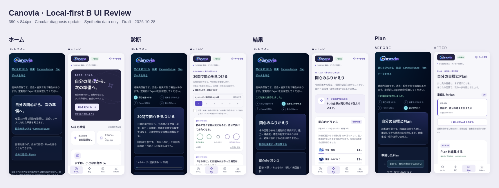

# Canovia Local-first B — UIレビュー用画像

2026-10-28 / [Draft PR #918](https://github.com/1kz-ma1/Canovia-web/pull/918) / **未統合・未公開**。仕様・安全性の正本は[既存戦略§19のUI追補](../../development/PRELAUNCH_PREPARATION_SHARED_DB_RELEASE_STRATEGY_2026_10_23.md#2026-10-28-local-first-b-uiux刷新候補experiencedraft限定)と[Issue #488](https://github.com/1kz-ma1/Canovia-web/issues/488)。このページは画面判断のための補助資料です。

「自分の関心から、次の準備へ」。明るい紙面、紺のヒーロー、藍の操作色で、診断→ふりかえり→自分のPlanをつなぎます。背景・文字・余白・カード・入力・focusを共通化し、モバイルは下部4項目＋headerのデータ管理です。



まず確認してほしいのは3点です。操作や個人データの提供は不要です。

1. 明るい背景・藍のアクセント・余白と、ホームの「次にすること」がCanoviaに合うか。
2. 6ページ×5問、選択タイル、移動時保存という診断の密度がよいか。
3. Planの「目標→現在地・最初の一歩→分野/目標日」が書きやすそうか。

| 画面 | Before | After |
| --- | --- | --- |
| 未開始Home | [旧UI](before-home.png) | [新UI](after-home.png)・[Planあり](after-home-saved.png) |
| 診断 | [旧UI](before-diagnosis.png) | [新UI](after-diagnosis.png)・[設問までスクロール](after-question.png) |
| 30回答済み結果 | [旧UI](before-result.png) | [新UI](after-result.png) |
| 保存済みPlan | [旧UI](before-plans.png) | [一覧](after-plans.png)・[編集](after-plan-editor.png)・[初回入力](after-plans-empty.png) |
| Future / Backup | — | [Future](after-future.png)・[データ管理](after-data.png) |
| 起動失敗 | — | [保存領域を開けない場合のSTOP](after-error.png) |
| 幅の違い | — | [320px](after-home-320.png)・[1280px](after-home-desktop.png) |

撮影はloopback配信の実アプリをLinux Chromium 154 / Playwrightで操作したものです。合成の診断・Planのみ。390×844px（小幅320、desktop1280×900を除く）。画像モックではありません。Afterの製品Sourceは `f8d514b88d5b038133e712ba458126541948099f`、Beforeは `ed6a18a63dac1efbba81999fa0a9611f1c3be104`。比較シートはブラウザで原寸画像を縮小配置して撮影しています。画像ファイル自体は個別の原スクリーンショットです。

Beforeの診断は初回ページで1回答を選択中、結果は30回答済み、Planは合成の保存済み1件です。AfterのHome/診断/空Planは新規の検証用context、保存済みHome/結果/Planは旧UIと同じ専用persistent profile・Originの記録です。起動失敗は新規contextでIndexedDB openだけを合成例外にした負例です。実際のiPhone画面・Safari受入証拠として扱わないでください。

ローカルテストは採点/JSONのpure10件、PHP133ケース一致、B/C browser回帰、mobile追加回帰、配布12件・Render計画11件がPASS。主要6画面のaxe検出違反0は限定的な自動検査です。再現コマンド・hash・未検証範囲は§19参照。GitHub Actionsは無料枠の都合で未実行。Safari/WKWebView、VoiceOver、native Files、iOS upgradeは未検証です。

新UI採否決定まではiOS pin/HTML/hash、iOS #20/#22、mainを変更しません。採用後のCIとiOS取込は別工程です。`PRODUCTION_NO_GO_HOLD` / `release_approved=false`。

## ローカル再現

専用clean checkoutと新規の一時出力先を用います。PHPはLaravel/bootstrap/DBを起動しないpure scriptだけを実行。Playwright 1.56.1とbrowserは検証環境側に用意します。system Chromium使用時のみ `CANOVIA_BROWSER_EXECUTABLE_PATH` を指定できます。公開用wrapperや実Originは使いません。

```sh
PREP_UI_TMP=$(mktemp -d)
php scripts/ci/preparation_static_data.php --data > "$PREP_UI_TMP/data.mjs"
cmp preparation-local/src/data.mjs "$PREP_UI_TMP/data.mjs"
php scripts/ci/preparation_static_data.php --vectors > "$PREP_UI_TMP/vectors.json"
PREPARATION_VECTOR_PATH="$PREP_UI_TMP/vectors.json" node preparation-local/test/core.test.mjs
node preparation-local/test/backup.test.mjs
python3 -B scripts/ci/preparation_static_build.py --out "$PREP_UI_TMP/B"
python3 -B scripts/ci/preparation_static_build.py --profile C --out "$PREP_UI_TMP/C"
python3 -B scripts/ci/preparation_static_security_test.py
python3 -B scripts/ci/preparation_static_render_test.py
PREPARATION_DIRECTORY="$PREP_UI_TMP/B" PREPARATION_VECTOR_PATH="$PREP_UI_TMP/vectors.json" BROWSER_ENGINE=chromium node tests/browser/preparation_static.mjs
PREPARATION_DIRECTORY="$PREP_UI_TMP/C" PREPARATION_VECTOR_PATH="$PREP_UI_TMP/vectors.json" BROWSER_ENGINE=chromium node tests/browser/preparation_static.mjs
PREPARATION_DIRECTORY="$PREP_UI_TMP/B" BROWSER_ENGINE=chromium node tests/browser/preparation_mobile_ui.mjs
```

最後のUI検査に `AXE_SOURCE=/absolute/path/to/axe.min.js` を渡すと同じ自動a11y検査を追加できます。今回は検証環境のaxe-core 4.11.0を使用。製品に同梱しません。WebKit実行stepはCIに残していますが、今回の環境にWebKit binaryがなく、ダウンロード先も許可対象外のため実行していません。Chromiumを代用してWebKit PASSと記録しません。
